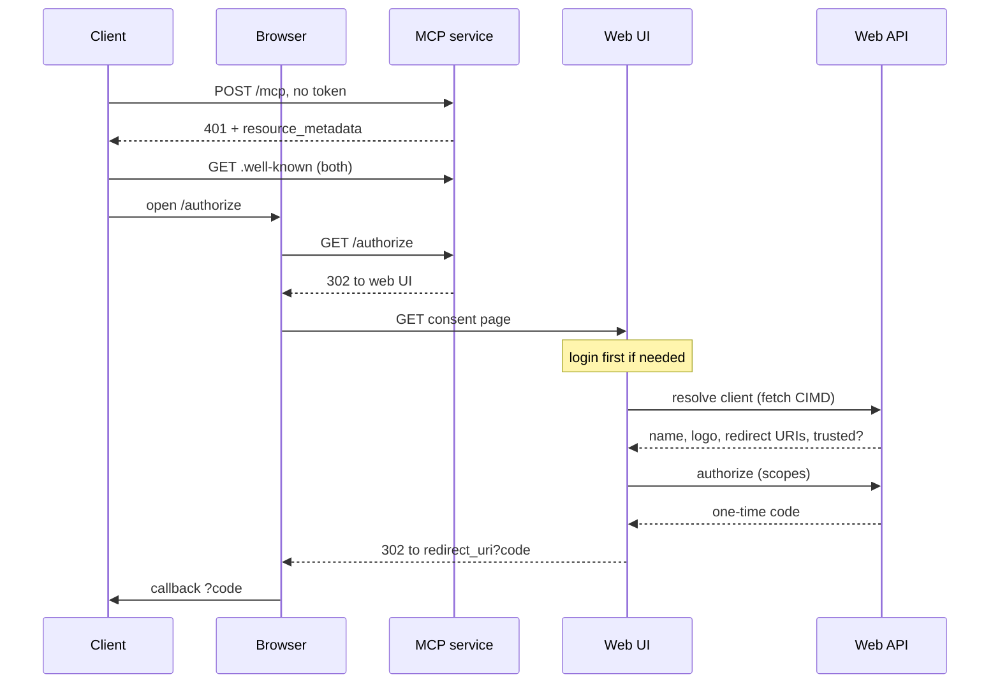
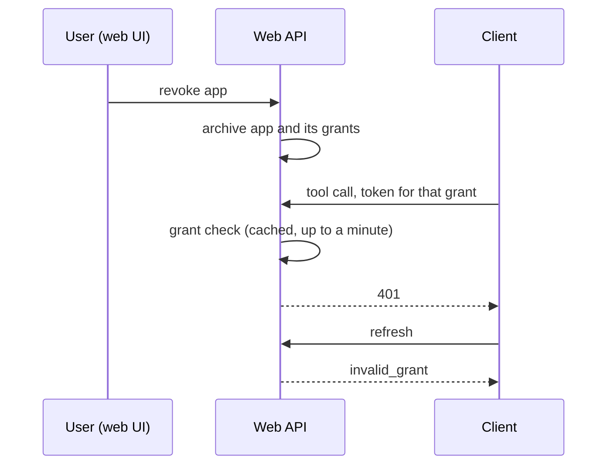

# RFC 0001: OAuth apps and grants

## Status

Draft (2026-10-22). Deferred: for now OAuth stays limited to the MCP service as
built in [ADR 0016](../adrs/0016.oauth-for-the-mcp-service.md), and the MCP code
is being hardened first. This RFC records where we want to take it afterwards.

## Summary

Let any interactive app act for a user through OAuth, not just MCP clients, and
give the user one place to see and revoke what has access. Apps identify
themselves with a client ID metadata document (CIMD). Scripts, libraries and
local tooling keep using API keys and MCP keys. Tokens issued through OAuth
become scoped and tied to a grant, so they can be revoked and so they cannot do
everything a login session can.

## Motivation

ADR 0016 gave remote MCP clients a standard way in, but it left four gaps:

1. **Tokens are as powerful as a login cookie.** The OAuth access token is the
   `stamp_for_mcp` token, which has the `general` audience that the WebAPI
   treats like a session. The WebAPI has a public hostname, so a holder of such a
   token can call any use case directly, including changing the password.
   Access through the MCP service is curated; access through a token is not.
2. **No management.** A user cannot see which apps are connected, when they last
   refreshed, or revoke one. Revoking would mean deleting rows by hand.
3. **Apps are anonymous.** Any `client_id` string is accepted and the redirect
   URI is checked against a fixed list. The metadata we publish says
   `client_id_metadata_document_supported`, but we never fetch the document, so
   nothing can show an app name or check its redirect URIs.
4. **Everything is one row.** A consent, its one-time code and its refresh
   token chain share one entity, so reconnecting an app five times gives five
   unrelated rows with the same client ID.

## Goals and non-goals

Goals:

- Any interactive app that can host an HTTPS page can request access.
- Users can list apps, see each app's grants, and revoke an app or one grant.
- OAuth access is scoped and enforced by the WebAPI, with revocation taking
  effect within about a minute.
- One authorization model shared by MCP and, later, the REST API.

Non-goals:

- **A client registry and developer portal.** Apps are self-describing. A
  registry with client secrets is possible later (see Alternatives).
- **Dynamic client registration.** MCP clients that only support it cannot
  connect. If that bites, `/register` is a thin layer on the same model.
- **Machine access.** API keys and MCP keys already cover scripts, libraries,
  stdio MCP and servers we or the user run. No client-credentials flow, and no
  device flow for now.
- **Scopes for API and MCP keys.** Keys stay full-power. Worth revisiting so one
  access page can use one scope vocabulary.

## The shape of auth

Four kinds of credential, all ending as a short-lived JWT that the WebAPI
verifies.

| Credential | Held by | Exchanged for | Token lifetime | Power |
| --- | --- | --- | --- | --- |
| Password, Google, Apple login | A person at the web UI | Session token in a cookie | 1 month | Full user |
| API key | A script or library | A token on every request | 1 minute | Full user |
| MCP key | A local MCP client | A token per connection | 1 hour | Full user |
| OAuth refresh token | A connected app | A token at `/token` | 1 hour | Scoped, bound to a grant |

The first three exist today. The OAuth row exists in a simpler form (ADR 0016)
and is what this RFC changes.

A short rule of thumb for which to use: if the person would not paste a secret
into the app, it needs OAuth.

## Entities

Existing: `User`, the login methods (`AuthLocal`, `AuthGoogle`, `AuthApple`),
`EmailVerificationAttempt`, `APIKey`, `MCPKey`.

New, both under the user:

**`OAuthApp`** is one row per user and client. It is the item on the connected
apps list.

- `client_id`: the metadata URL.
- `name`, `logo_url`, `client_uri`, `redirect_uris`: a snapshot of the client's
  document taken when the user first approves.
- `verified`: whether the client was on the trusted list at that moment.
- `scopes`: what the user consented to.
- `resource`: what the app is allowed to talk to.
- First authorized time. Revoked state is the existing archive.

**`OAuthGrant`** is a child of the app. It is one connection, usually one
device.

- The redirect URI used and the PKCE challenge.
- The one-time code (hashed) and whether it was redeemed.
- The current and previous refresh token (hashed), and when the current one was
  issued.
- An absolute expiry, so a refresh chain cannot live forever.
- A revocation reason: user, reuse detected, cleanup.

Not entities:

- A short-lived cache of fetched client documents.
- The trusted client list, kept as configuration (exact client ID URL).
- The scope table.

Every field is a domain value with its own validation, none borrowed from the
API key module: `OAuthClientId`, `OAuthResource` (the RFC 8707 resource
indicator: the URL of the server the access is for), `PkceCodeChallenge` and
`PkceCodeVerifier`, `SystemUrl` for the redirect URI, and `OAuthSecretPlain` and
`OAuthSecretHash` for the secrets. Codes and refresh tokens reach clients as
`OAuthCodeExternal` and `OAuthRefreshTokenExternal` (`oc_` or `or_`, the grant id
and the secret), so a refresh token cannot be passed as a code. Secrets are
argon2 hashes. The storage layer cannot hold a null secret hash, so the grant
stores a placeholder hash until its code is redeemed. The table for `OAuthGrant` is
`o_auth_grant` because of how the ORM names tables; check generated names
before writing migrations.

Today's single `OAuthGrant` entity splits into these two.

## Use cases

For the signed-in user (web UI):

- **Authorize:** the consent step. Finds or creates the app, creates a grant and
  its code, and records the scopes.
- **Find apps:** one row per app with its name, live grants, last refreshed.
- **Load app:** one app with its grants.
- **Revoke app:** archives the app and all its grants.
- **Revoke grant:** one device only.

For the protocol (guest):

- **Resolve client:** fetch and validate the client's metadata document, and
  return the name, logo and redirect URIs. Done in one place (the WebAPI) so the
  fetch is guarded against internal addresses, size and time limits, and caching
  is shared.
- **Exchange code, refresh:** these exist. They must also fail for a revoked
  app, and the refresh must enforce the absolute cap.
- **Revoke token (RFC 7009):** a client drops its own refresh token. The
  Inspector calls this when stored OAuth state is cleared.
- **Grant check:** internal, asked by the WebAPI.

Housekeeping (cron, following the existing `gc` module):

- Delete unredeemed grants after about an hour.
- Expire grants past their refresh deadline, and keep them visible as expired
  for a while.
- Archive apps that have had no live grants for 30 days.
- Delete old archived rows.

Notifications (later): an email when an app first connects, and when reuse
detection revokes a grant.

## Lifetimes

| Thing | Lifetime | Notes |
| --- | --- | --- |
| Authorization code | 10 minutes, single use | The grant exists from this point, so unredeemed ones need cleanup. |
| Access token | 1 hour | A JWT. Never stored. |
| Refresh token | 30 days of inactivity | Rotates on every use. |
| Grant | Absolute cap, proposed 180 days | After that the user reconnects. |
| App | No expiry | Hidden once it has no live grants. |

## Token rules

These make access safe. They are the important part of the RFC.

1. OAuth access tokens get their own audience and carry the scope, the client ID
   and the grant ID. They are not interchangeable with session tokens.
2. The WebAPI decides which use cases an OAuth token may call. The default is
   none: exposing a use case is an act of will, as in ADR 0004.
3. Scopes map onto the existing use case kinds: `read` allows read-only use
   cases, `write` allows mutations. Finer scopes, per area such as todos or
   habits, can come later.
4. Credential and security use cases are never callable with an OAuth token:
   password and email changes, creating or archiving keys, revoking apps. An app
   must not be able to widen its own access.
5. The grant ID in the token lets the WebAPI check that the grant is still
   active, behind a cache of about a minute. Revoking an app then takes effect
   within a minute rather than an hour.
6. Presenting a used code, or an old refresh token, revokes the grant.

Initial scopes: `mcp`, `read`, `write`.

## Flows

### Connecting an app

The consent page shows the app's name, logo, the host of its client ID, the
scopes being requested, and whether it is on the trusted list. The document is
self-asserted, so anyone can claim to be a well-known app. The host is the trust
signal, and `verified` means the exact URL is on the list.

### Using and refreshing tokens

As in ADR 0016. The client holds the 1 hour JWT and sends it as the bearer
token. The MCP service only checks that it has not expired, so it can answer
401 early. The WebAPI verifies the signature, the audience, the scope and the
grant, on every call. A refresh rotates the refresh token and retires the old
one.

### Revoking

## Alternatives considered

- **One entity for app and grant.** Cheapest, and the UI can group by client
  ID. But there is nowhere to hold per-app data (cached name, consented scopes),
  and a revoke of the app cannot be told apart from a revoke of one device.
- **A global client registry.** Needed for apps with a client secret, such as
  Zapier-style integrations, and for a verified publisher program. It brings a
  developer portal, secret rotation and review. Not needed for self-describing
  apps. If added, the app records how it identified itself, so registered apps
  are another value of the same field.
- **Dynamic client registration only.** Clients register again on each fresh
  connection, which creates clutter and needs expiry. CIMD is the preferred
  route in the MCP specification, and DCR the fallback.
- **Opaque access tokens stored in the database.** Instant revocation, but a
  lookup on every request. The grant check with a short cache gets most of the
  benefit without it.
- **Short JWT with no grant check.** Simplest, but revocation lags by the token
  lifetime, up to an hour.

## Open questions

- Is a 180 day absolute cap right, or should refresh tokens only idle out?
- Trusted list by exact client ID URL, or by host?
- Should a reconnect skip the consent screen when the app already exists?
  Proposed: no, prompt every time.
- Email notifications on first connect and on reuse revocation?
- Scopes for API and MCP keys, and a single access page for keys and apps?

## Build order

1. Token hardening: the new audience, scopes and grant ID claims, and WebAPI
   enforcement. This fixes the exposure in the motivation, so it comes first.
2. Split the entity into app and grant, with migrations.
3. The management page with revoke, and the grant check.
4. The client resolver and the consent page changes.
5. Housekeeping and notifications.
6. Let the REST API accept OAuth tokens, with scope checks.

Steps 1 to 3 do not depend on CIMD and could ship with MCP only.

## Relationship to existing decisions

- Extends [ADR 0016](../adrs/0016.oauth-for-the-mcp-service.md), which covers the
  MCP-only version already built.
- Keeps the key model from [ADR 0004](../adrs/0004.api-and-mcp.md): keys sit under
  a user, and services expose things deliberately.
- If accepted, it should be turned into an ADR that supersedes the parts of ADR
  0016 about client identity and token power.
