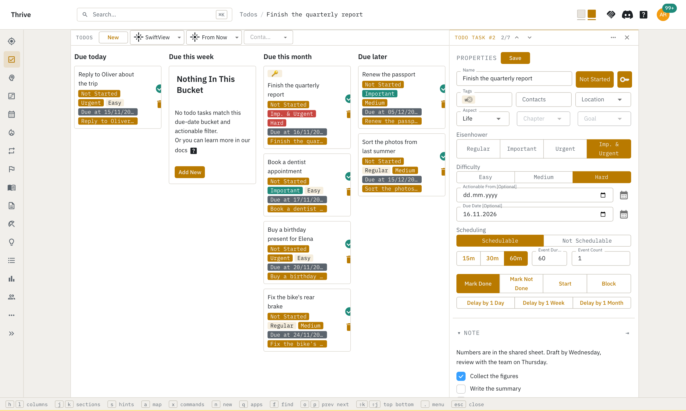
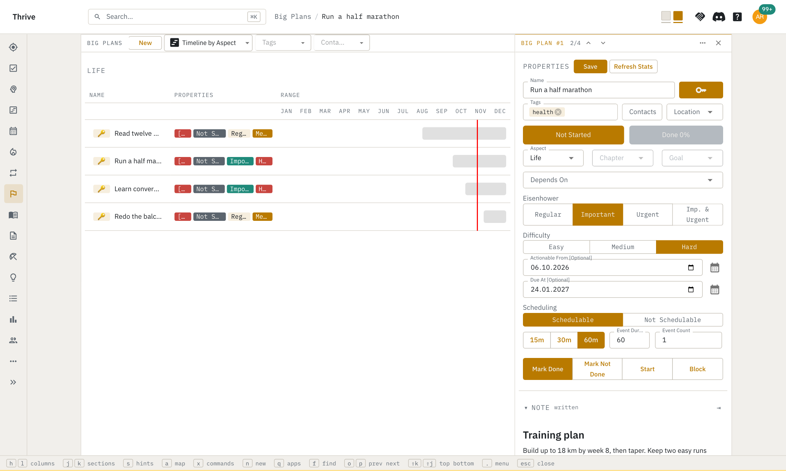

# Notes

Notes are lightweight pieces of text attached to entities to keep context close
to the work.

Use notes for things like:

* supporting details,
* checklists,
* links and references,
* short rationale or reminders.

## Why Notes Matter

Notes keep critical context next to the entity itself, so you do not need to
jump across tools to understand what to do next.

Notes are especially useful for entities that evolve over time, such as:

* [Todos](../todos.md),
* [Metrics](../metrics.md),
* and other planning entities.

## Notes And Lifecycle

When source entities are archived, related notes follow the same lifecycle, so
your workspace stays consistent.

For lifecycle details, see [Removal](../archival-and-removal.md).
