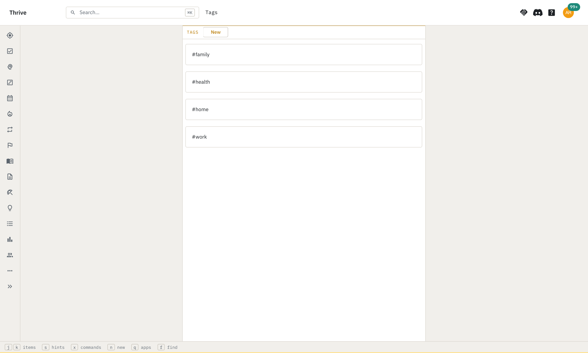
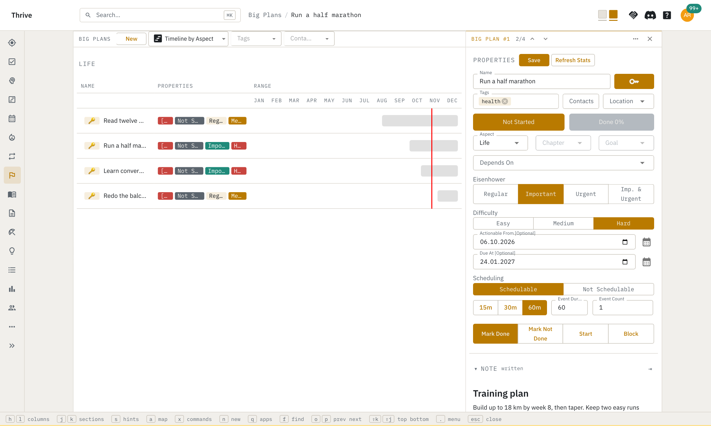

# Tags

Tags are reusable labels that help you classify and retrieve entities quickly.

A tag can be attached to multiple entities, and an entity can have multiple
tags.

## Typical Uses

Tags are useful for:

* thematic grouping (for example, `health`, `finance`, `family`),
* workflow grouping (for example, `waiting`, `deep-work`),
* review flows (for example, `weekly-review`).

## Where Tags Help Most

Tags are particularly powerful in combination with:

* [Smart Lists](../smart-lists.md),
* [Search](../../tools/search.md).

Using a small, consistent tag vocabulary makes filtering and reporting easier
over time.
