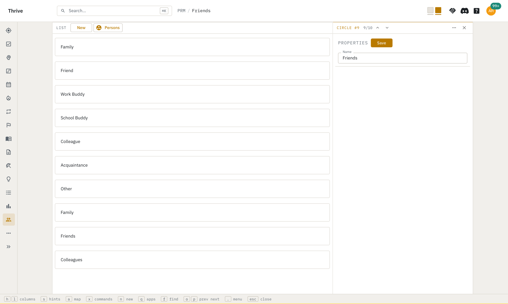
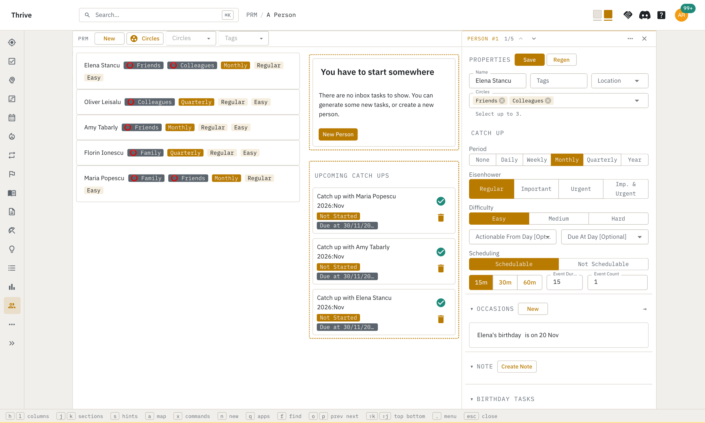

# Circles

You can define _circles_ - labels for people in your life.

You can have one for your friends, another for your family, etc.

People can belong to several circles at the same time, but no more than three.

