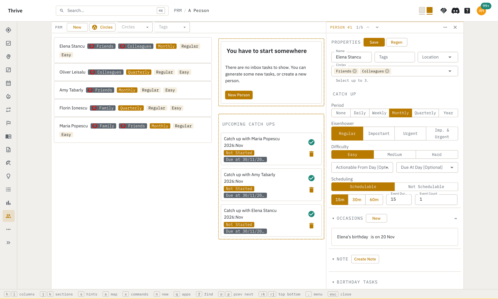

# Persons

A person has a name, and it must be unique.

A person can also belong to [circles](circles.md). It can belong to 0, 1, 2, or
at most three of them, to signal belonging to friends, family, colleagues, etc.

A person can have a defined _catch up period_. Some guideline for how often you
should try tocatch up with them - a message, a call, or even a dinner would all
count. Correspondinginbox tasks are [generated](../tasks-generation.md) in the PRM
_catch up aspect_ much likewith [metrics collection](../metrics.md).

* There are a number of other optional parameters which control how the catch up
  inbox task is
  setup, and they have the same meanings as for [habits](../habits.md).
* If the period is missing, then no generation occurs, and the whole parameter
  set is ignored.

A person can have multiple [occasions](occasions.md) - birthdays, anniversaries,
holidays,  and other recurring events. Inbox tasks are generated
yearly for each occasion, with markers in the calendar too.

## Catch Up Settings

In the web app you set the catch up of a person from their own page, in the
`Catch Up` section: the period, the Eisenhower status and difficulty of the
generated tasks, and when they can be started and are due. Pick `None` as the
period to turn the generation off for that person.

