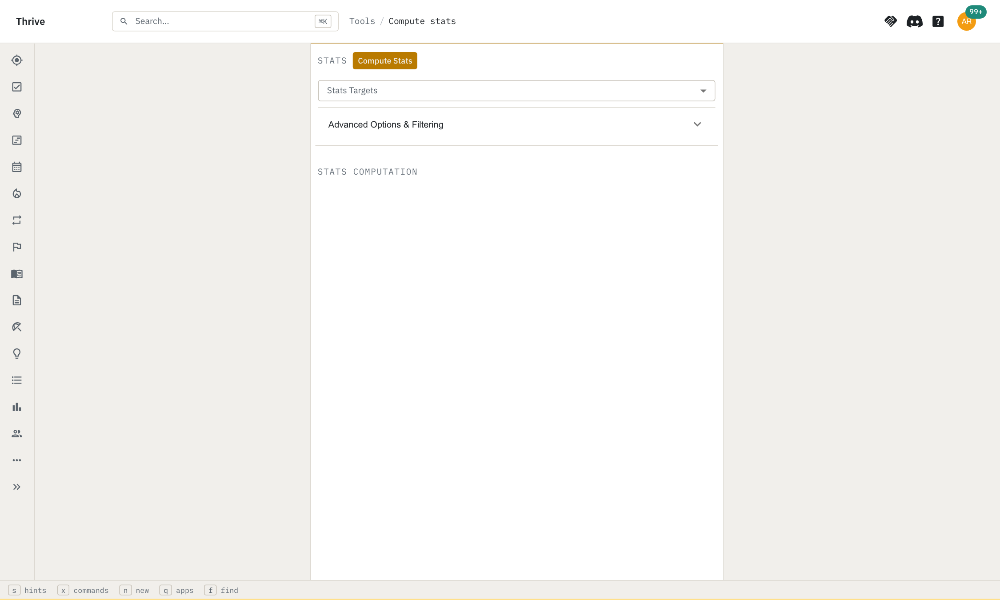

# Stats

Thrive gathers _statistics_ around the work that you're doingin many ways: big
plan progress, habits streaks, journal-levelgeneral activities, time plan
efficiency, gamification scores, etc.

These are both another, more quantiative way of looking at thework that youre
doing, and a tool to help you plan better forthe future.

Many of these statistics are computed in an online fashionas you're using
Thrive. There is a periodic process thatcomputes these across the board, for
cases where it's impracticaland for situatins where errors or bugs mean
computationdidn't happen correctly.
