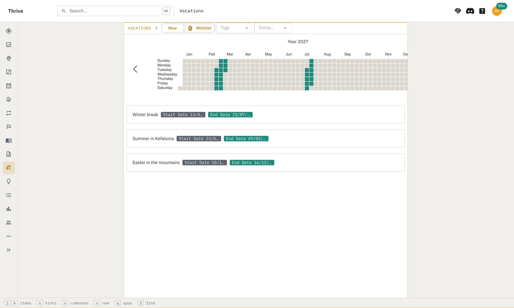
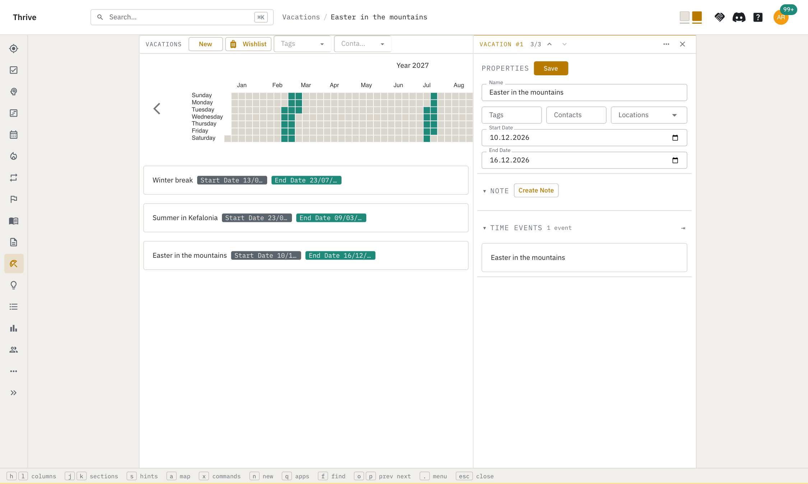

# Vacations

A _vacation_ is a set period of time when some scheduled tasks aren't scheduled.
These are essentially chores that do not have the _must do_ attribute set.

Vacations are attached to the workspace. You can see them in the `Vacations`
left-hand menu tab. An example:

The Vacations app has two views:

* **Vacations** — dated trips. During those dates, chores that are not marked
  _must do_ are not generated.
* **Wish list** — places you want to visit, without dates yet.

Alternatively you can see vacations via `vacation-show` in the CLI, and travel
wishes via `travel-wish-show`.

## Vacation Properties

A vacation has a name.

The start date is the time when the vacation starts, and tasks should not be
generated. It should be before the end date.

The end date is the time when the vacation ends, and tasks should again be
generated. It should be after the start date.

A vacation can also carry tags, contacts, and one or more locations.

Each vacation shows up on the [calendar](calendar.md) as a full day event
covering the whole trip. Vacations can be
[shared](collaboration.md) with other Thrive users, and
[published](publish.md) as a public read-only page.

## Travel Wishes

A _travel wish_ is a place you would like to visit. It lives in the same
Vacations app, under the wish list view.

You create a wish by picking a location. The wish starts with that location's
name. Afterwards you can rename it, and attach more locations, tags, and
contacts.

When you are ready to go, you can create a vacation from a wish. That copies
the name, tags, contacts, and locations onto a new vacation — you supply the
start and end dates — and archives the wish.

Travel wishes can be [shared](collaboration.md) with other Thrive users, the
same way vacations can.
