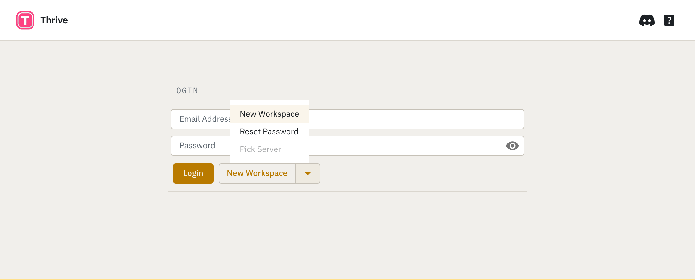
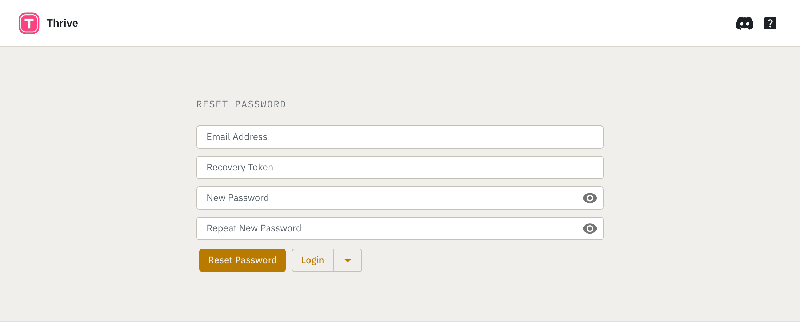

# Recover Your Account

If you somehow forget your account's password, you can recover your password by
using theaccount recovery feature and the recovery code that you got when
[creating your account](../how-tos/install.md).

From the login page open the menu next to the `New Workspace` button and
choose `Reset Password`:

You'll be presented with the account recovery form:

You'll need your account email and recovery token. After setting the new
password, your recoverytoken will be changed and you'll need to save that too in
a safe place.

If you've forgotten your account recovery token, please contact support!
