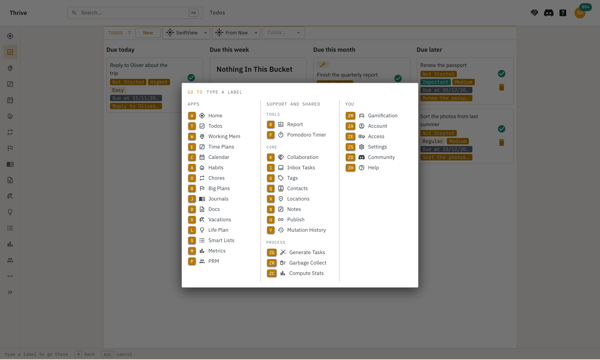
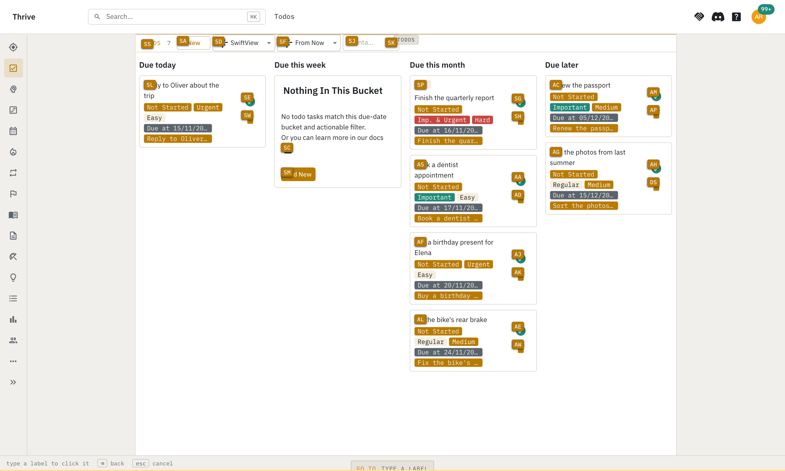
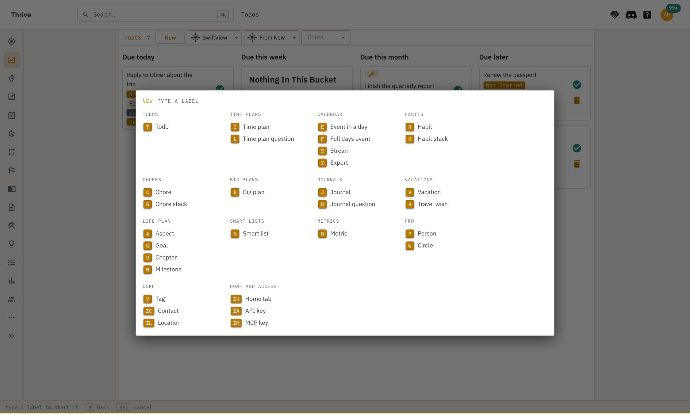
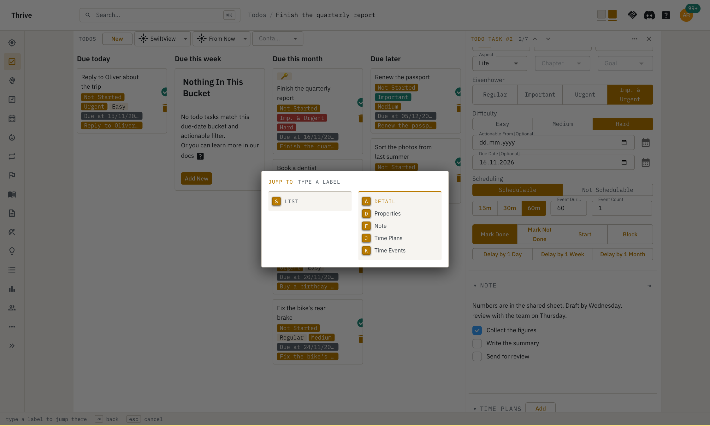
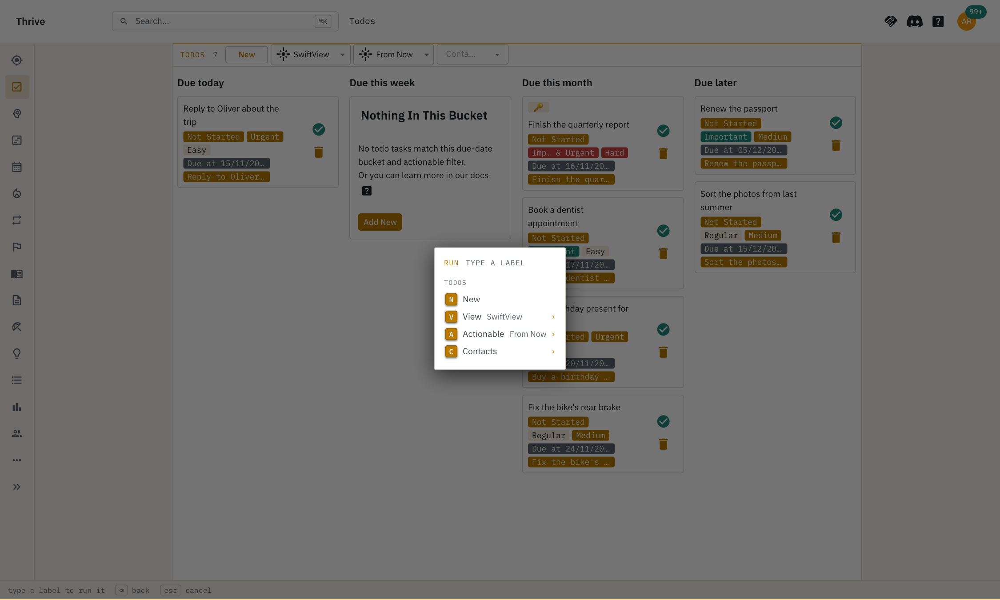
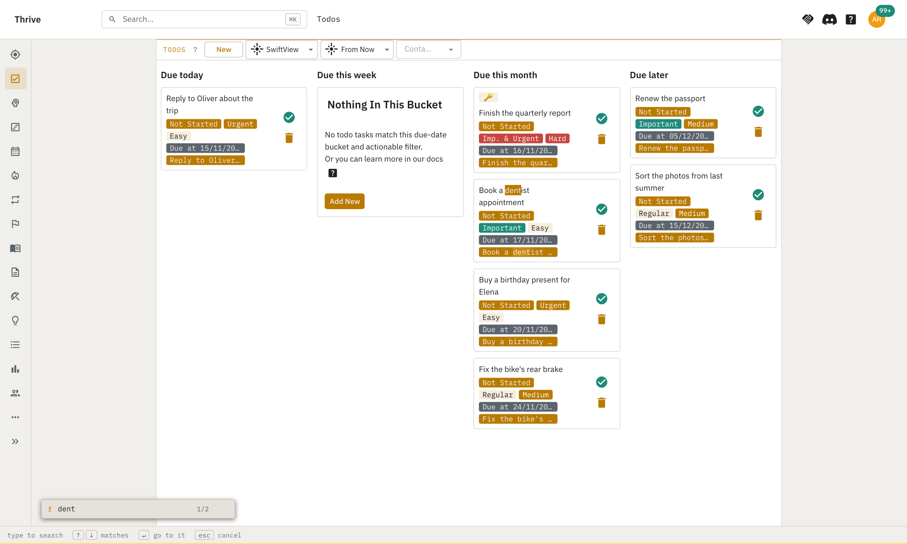

# Work With The Keyboard

This how-to teaches you to use Thrive's web app without reaching for the mouse.
You do not need to learn everything: the first few keys already save a lot of
clicking, and the footer of the app reminds you of the rest as you go.

For the complete list of keys, see [Keyboard Shortcuts](../tools/keyboard-shortcuts.md).

It applies to the web app on a big screen. On a phone the keyboard shortcuts are
mostly not available.

## Before You Start

Two ideas make everything else simple.

**Columns.** Thrive opens things side by side: a list in the first column, the
item you picked in the next, and sometimes more beside it. One column has the
_focus_, marked by an amber line along its top. Keys act on the focused column.

**The footer.** A strip along the bottom of the window lists the keys that work
right now. Whenever you are not sure what to press, read the footer. It changes
as you move around, and it always shows the keys you actually have.

Keys that are a single letter do not work while you are typing in a field, so
you will never type a `j` into a note by accident. Press `Esc` to leave a field
and get your keys back.

## 1. Go To An App

1. Press `q`. A menu covers the window with every app and page you can go to,
   each with a letter or two next to it.
2. Type the letters of the one you want, such as the one next to **Habits**.
   You are taken there at once.
3. If you pressed `q` by mistake, press `Esc`.

The letters come from the names, so they are easy to guess, but you never have
to guess: they are drawn on screen.

## 2. Pick An Item And Open It

You are now in the first column of the app, a list.

1. Press `j` to move down the list, and `k` to move up. The item under the
   cursor is marked with a line on its left.
2. Press `↵` to open it. Its column appears to the right and takes the focus.
3. Press `Esc` to close the column and go back to the list.

If the list does not have the cursor yet, `e` also goes into it, at the first
item.

## 3. Move Around An Item

An item can have many sections: its own properties, then notes, lists of related
things and so on.

1. With the item's column focused, press `j` to go to the next section, and `k`
   to go back. The section that has the focus is marked with a line on its left.
2. Press `↵` to go inside it. If the section is a note, you start editing it,
   with the caret at the end. If it is a list, the first item is opened.
3. Press `e` to go into the list of a section without opening anything. Then `j`
   and `k` move between its items, `↵` opens the one you are on, and `Esc` goes
   back up to the section.
4. Press `z` to collapse a section you do not need, and `z` again to open it.
   The first section, the item's own properties, cannot be collapsed.

Press `Esc` to leave a field you are typing in. What you typed is kept, and you
are back on the section, so `j` and `k` work again.

## 4. Move Between Columns

When you have more than one column open:

1. Press `h` to focus the one on the left and `l` for the one on the right.
2. Press `c` on a section to split it out into a column of its own, which is
   good for keeping a long list or a note next to the thing you are working on.
3. Press `⇧c` (that is, `Shift` and `c`) in a split column to fold it back.
4. Press `a` to jump to any column or section directly. See
   [below](#7-jump-straight-to-a-column-or-a-section).

## 5. Press Anything With Hints

Some things have no key of their own: a checkbox, a drop-down, a button in a
form. For those there are hints.

1. Press `s`. Every link, button, field, toggle, tab and menu item in the columns
   gets a label of one to three letters.
2. Type the letters of the label of what you want. It does what a click would:
   a field gets the cursor, a drop-down opens, a button is pressed.
3. If you typed a wrong letter, press `Backspace`. To give up, press `Esc`.

Labels that are close together on the page start with the same letter, so you
can narrow down as you type.

## 6. Create Something New

1. Press `n`. A menu lists everything you can create, grouped by app.
2. Type the letters of what you want, such as a habit or a tag.
3. Fill in the form. Press `Esc` when you want to leave a field and use the
   other keys again.

Or, if you are in a column that has a button to create things, press `x` to open
the commands of the column, and type the letters next to **New**.

## 7. Jump Straight To A Column Or A Section

If `h`, `l`, `j` and `k` take too many presses:

1. Press `a`. The open columns are drawn as boxes, with their sections under
   them, each with a label.
2. Type the label of the column or section you want. A column is focused, a
   section is taken to and scrolled to its top.

## 8. Run The Actions Of A Column

1. Press `x`. A menu lists everything you can do in the focused column, under
   the section each action belongs to: the buttons, the filters and the entries
   of the `⋯` menu.
2. Type the letters of an action to run it, as if you had pressed its button.
3. A filter, such as which tags to show, is marked with `›`. Typing its letters
   opens its choices. When there are many choices, type to search them, use `↑`
   and `↓` to move, and `↵` to turn one on or off. `Esc` goes back to the list.

## 9. Find Text On The Page

1. Press `f` and type what you are looking for. Every match in the open columns
   is marked, and the current one stands out.
2. Use `↓` and `↑` to step through the matches.
3. Press `↵` to go to the match. This also ends the search. If the match is a
   link or a button, the focus is on it, so another `↵` follows it. If it is in
   a note, the caret is there.
4. Press `Esc` to end the search where you were.

This finds text in the columns you can see. To search across your whole workspace,
press `⌘K` (`Ctrl+K` on Windows and Linux) instead. See [Search](../tools/search.md).

## 10. Go Through A List Of Items

When you have opened an item from a list, you can go on to the next one without
going back to the list.

1. Press `p` to open the next item of the list, and `o` for the previous one.
2. Look at the header of the column, which shows your place, such as `12/63`.

## 11. Other Useful Keys

* `.` opens the `⋯` menu of the focused column, with History, Publish, Access,
  Archive and so on.
* `Home` or `⇧k` scrolls the focused column to its top, and `End` or `⇧j` to its
  bottom.
* `Esc` closes the focused column when nothing else is open, except for the first
  column of an app.

## Make The Keys Yours

If a key does not feel right, such as when it clashes with your keyboard layout
or the way you are used to, you can change it.

1. Open **Account** from the right-hand menu and go to the **Keys** section.
2. Click the key of the action you want to change.
3. Press the key you want instead. The change is saved right away.
4. If you cannot use it because another action has it, the page says which one.
   Move that one first.

**Reset to defaults** puts everything back. The footer from now on draws your
keys.

## If A Key Does Nothing

* Are you in a field? Press `Esc` to leave it. Keys of a single letter do not
  work while you type.
* Is a dialog or a menu open? Press `Esc` to close it.
* Is a modifier held down? Keys with `Ctrl`, `Alt` or `Cmd` are left to the
  browser.
* Is it listed in the footer? Keys are only active where they do something: `z`
  needs a section, `⇧c` needs a split column, and `x` needs something to run.
* Are you on a phone? Most keys are only for big screens.
