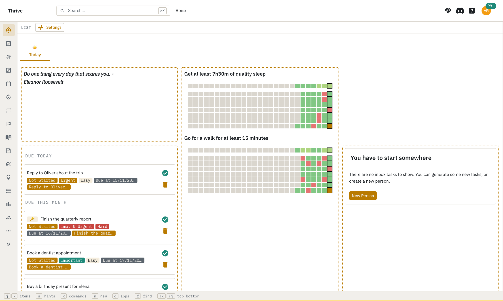

# Thrive

## About

Thrive is a tool for _life planning_. It provides goals management, task
tracking, work planning,habit building, a journal, chores management, lists,
metrics, a personal relationship manager, andmuch more. All in a unified
package.

I built it to [solve an issue I had](http://www.paulgraham.com/organic.html) -
making sure everythingI wanted to get done actually got done, while juggling the
standard complexities of life - family, kids, career, etc.

Inspiration comes from [Getting Things
Done](https://gettingthingsdone.com/what-is-gtd/),[The Deep Life
Stack](https://www.thedeeplife.com/podcasts/episodes/ep-252-the-deep-life-stack/),existentialist
philosophy, [Notion](https://notion.so), Todoist, and many others.

The current version is both a [webapp](https://get-thriving.com), a desktop
app,a mobile app, a PWA, and a [CLI application](how-tos/install.md). You can
even [self-host](how-tos/self-hosting.md) it.

Checkout the full list of [features](features.md), but here's a sneak peek
atwhat it can do.

Here's a picture of a typical "home" view:

And a picture from the "inbox" view:

And the calendar view:

And a metric feature:

And finally, a timeplan feature:

## Further Reading

Follow the [tutorial](tutorial.md) or [concepts](concepts/overview.md) to get a
feeling for what Thrive can do.
