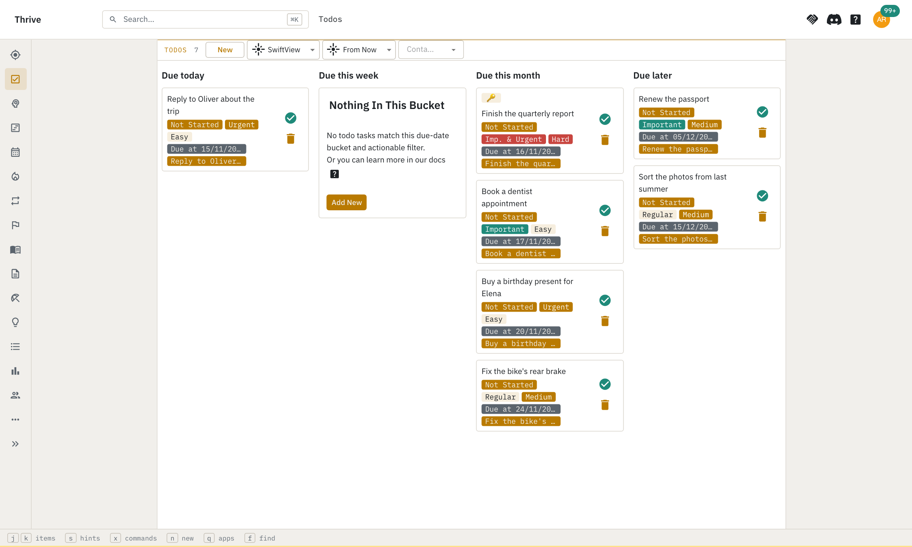
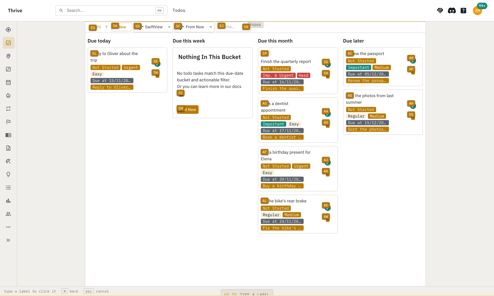
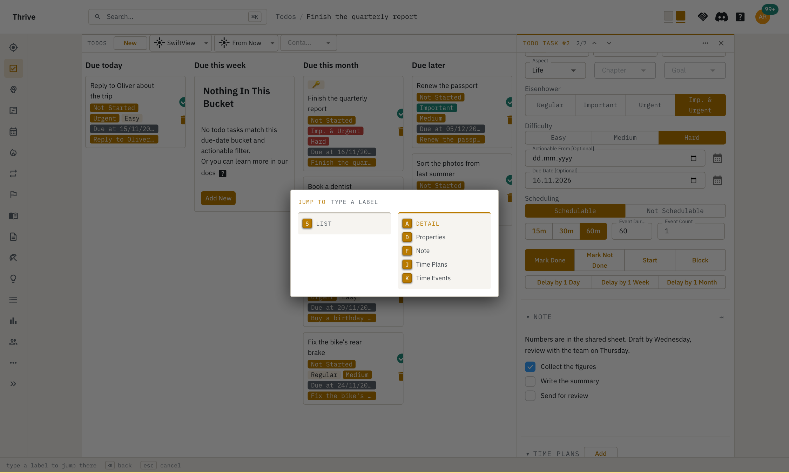
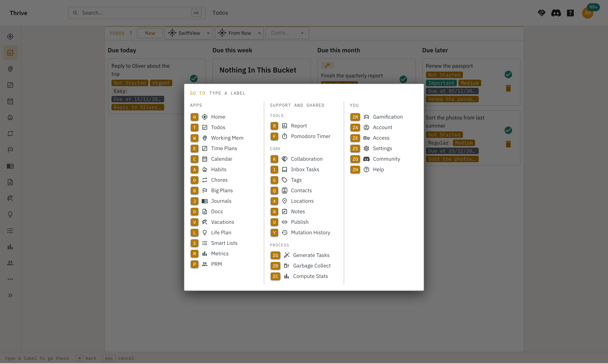
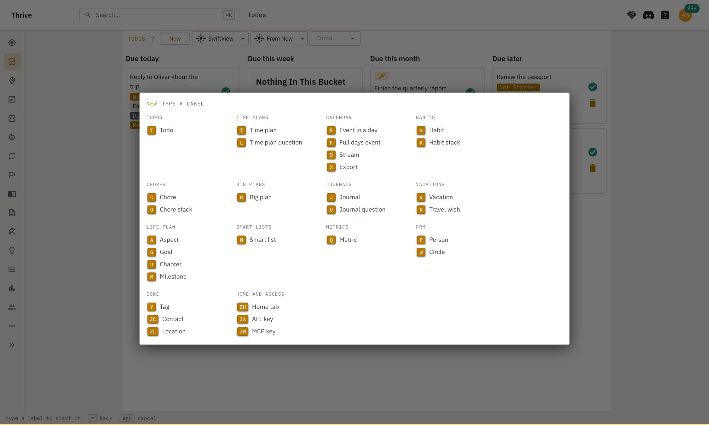
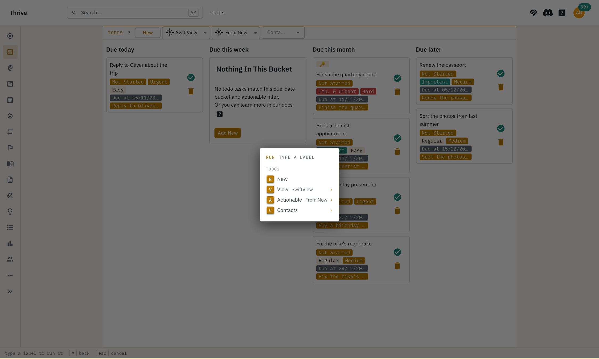
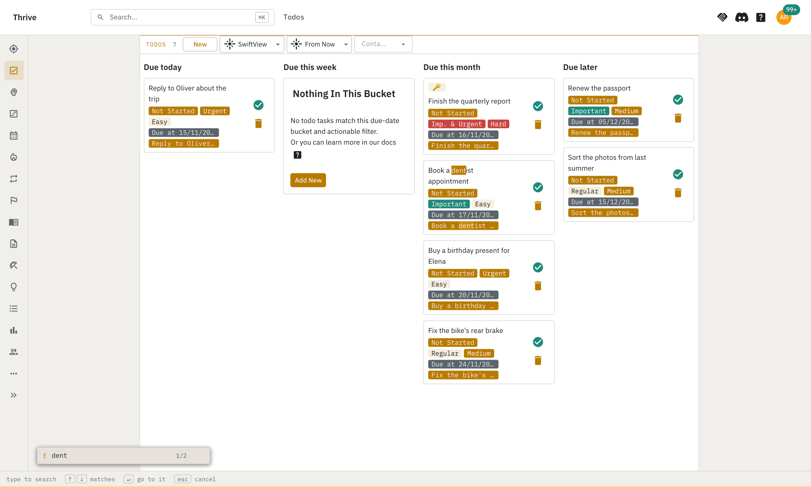

# Keyboard Shortcuts

The Thrive web app can be driven almost entirely from the keyboard, in the spirit
of Vim and Vimium: single keys that move around, open things and press buttons.
This page is the reference. For a guided tour, see [Work With The
Keyboard](../how-tos/work-with-the-keyboard.md).

Keyboard shortcuts are for the web app on a screen big enough to show columns.
On a phone there is no footer, and the menus of apps, new items and commands are
not available. They are not available in the CLI or the other clients either.

## The Footer

On a big screen a thin strip along the bottom of the window lists the keys that
work _right now_. It follows the focus: it only lists a key where that key does
something, and it changes while you are in a mode such as hints or find, to tell
you how to use the mode and how to leave it. When in doubt, look at the footer.

It also draws the keys _you_ chose, if you [changed them](#changing-the-keys), so
it is always accurate even when this page is not.

## When The Keys Work

The one-letter keys stay out of the way of typing. They do not work:

* while you are typing in a field (press `Esc` to leave the field first);
* while a dialog or a menu is open, which keep their own `Esc`;
* with the `Ctrl`, `Alt` or `Cmd` key held down, so browser shortcuts such as
  reload keep working.

## The Default Keys

All of these can be changed. See [Changing The Keys](#changing-the-keys).

### Moving Between Columns

Thrive shows an entity and the things next to it as columns. One column has the
focus, marked with an amber line along its top.

| Key | What it does |
| --- | --- |
| `h` | Focus the column to the left |
| `l` | Focus the column to the right |
| `.` | Open the menu of the focused column (the `⋯` menu) |
| `Esc` | Close the focused column, or go back, see [Going Back](#going-back-with-esc) |
| `Home` or `⇧k` | Scroll the focused column to its top |
| `End` or `⇧j` | Scroll the focused column to its bottom |

`Home` and `End` always scroll, even if you give `⇧k` and `⇧j` other keys.

### Sections And Items

A column can have a stack of sections, and a section can have a list of items.
The first section of a stack is the entity's own properties: it is always open
and cannot be collapsed or split out.

| Key | What it does |
| --- | --- |
| `j` | Next section, or next item once you are inside a list |
| `k` | Previous section, or previous item once you are inside a list |
| `↵` | Go inside the section that has the focus: edit its note, or open the first item of its list. On an item, open it |
| `e` | Go into the list of the section, to the first item; or edit its note if it has one instead of a list |
| `z` | Collapse or expand the section that has the focus |
| `c` | Split the section that has the focus out into a column of its own |
| `⇧c` | Fold a split column back into its section |

`j` and `k` stop at the ends of the stack or the list; they do not wrap around.
Columns that are a list themselves, such as the first column of an app, work the
same way, but their items belong to the column rather than to a section.

### Jumping Anywhere

These keys open an overlay that labels what it can reach with letters. Type the
letters of a label to go there. They are described in more detail
[below](#the-overlays).

| Key | What it does |
| --- | --- |
| `s` | **Hints**: put a label on everything pressable or typeable in the columns |
| `a` | **Map**: jump to any open column or section |
| `q` | **Apps**: jump to any app or page |
| `n` | **New**: start creating an item of any kind |
| `x` | **Commands**: run an action of the focused column |
| `f` | **Find**: search the text of the open columns |
| `⌘K` / `Ctrl+K` | Open the [search](search.md) of the whole workspace |

### Along A Collection

When you open an item from a list, the header of its column shows its place in
the list, such as `12/63`.

| Key | What it does |
| --- | --- |
| `o` | Replace the open item with the previous one of the list |
| `p` | Replace the open item with the next one of the list |

They stop at the ends of the list. The same moves are available as the `⌃` and
`⌄` arrows in the header.

## The Overlays

Hints, map, apps, new, commands and find take over the keyboard while they are
open: the letters you type belong to them and not to the page behind. In all of
them:

* `Backspace` takes back the last letter you typed;
* `Esc` leaves the overlay and does not close any column;
* a shortcut with `Ctrl`, `Alt` or `Cmd` leaves the overlay and goes on, so
  `⌘K` still opens search;
* clicking away, or moving to another page, closes the overlay too.

### Hints

`s` puts a label of one to three letters on every link, button, field, select,
toggle, tab and menu item in the columns. The labels are all the same length,
and they are made of the home row and the letters near it. Labels that come one
after another on the page share their first letter, so typing a letter narrows
things down to a cluster. Each column that has a label in it is named at the top
so you can tell where a label goes.

Typing a label does what clicking would: a field gets the focus with the caret
at the end of its text, a select or a date opens its picker, and a button or link
is pressed. Things that are disabled, hidden, collapsed or covered are not
labelled. The rail, the top bar and the footer are not labelled either: they
have the keys `q`, `x`, `n` and `⌘K`.

### Map

`a` draws the open columns side by side over a dimmed window, each as a box with
its name and the sections of its stack under it. Every box and section has a
label of one or two letters. Typing one focuses that column, or takes you to that
section, scrolled to its top. Use it when `h`, `l`, `j` and `k` would take too
many presses.

It does not open when there is nothing to jump to.

### Apps

`q` opens a menu with three sections: the apps your workspace has enabled, the
support and shared pages (Tools, Core and so on), and what is on the right of
the top bar (account, access, settings, and so on). Every entry has a letter or
two taken from its name. Typing them goes there.

Sign-out and the legal pages are left out on purpose, so that a stray key press
cannot sign you out.

### New

`n` opens a menu with every kind of item you can create, grouped by app. Typing
the letters of one starts creating it. It lists the things that can be created
on their own, such as a habit or a tag, and not the ones that hang off another
entity (a milestone of a big plan, say): create those from the entity itself.

### Commands

`x` opens a menu of everything the focused column can do, grouped under the
section each action belongs to: the buttons of the section (create, add and so
on), its navigation, its filters, and the actions of the `⋯` menu. Typing the
letters of a command runs it, as if you had pressed its button.

A filter is listed with the value it has now, and marked with `›`. Typing its
letters opens a panel of its choices, each with letters of its own. A filter with
only a few choices sets the one you type and closes the menu. A filter with many
choices, such as tags, turns into a search instead:

* type to search (every word has to match, and matches that start with what you
  typed come first);
* `↑` and `↓` move along the matches;
* `↵` turns the match under the cursor on or off, and the menu stays open so you
  can pick more;
* `Backspace` on an empty search, or `Esc`, goes back to the list.

The rarely wanted commands, the `⋯` menu ones and the previous and next item, are
kept together in the last group, at the right.

The column must have something to run for `x` to open the menu.

### Find

`f` opens a field at the bottom left. What you type is marked everywhere in the
text of the open columns, whatever the case, and the current match stands out.

* `↓` and `↑` step through the matches, going round at the ends;
* `↵` goes to the match **and ends the search**: its column is focused, and the
  keyboard focus is on the link or button it is in, so another `↵` follows it. A
  match inside a note puts the caret there, ready to type;
* `Esc` ends the search and puts the focus back where it was.

Pressing `f` again starts a new search with the last query typed in and
selected. Find only searches what is on screen: not the rail or the top bar, not
what is collapsed or folded away, and not what is typed in a form field.

## Going Back With Esc

`Esc` goes back one step at a time, in this order:

1. leave hints, map, apps, new, commands or find, if one is open;
2. leave an item, back to the section it is in (the column stays open);
3. leave a field you were typing in, back to the section it is in; what you typed
   stays;
4. close the focused column, if it can be closed. The first column of an app
   cannot.

Dialogs, menus and lists of suggestions always keep their own `Esc`.

## Changing The Keys

Every key in the tables above can be changed, but for those that belong to an
overlay or a field: `Esc` in a field, `↵`, `↑` and `↓` in find, and the letters
and `Backspace` inside the overlays.

1. Open **Account** from the right-hand menu and find the **Keys** section.
2. Actions are listed in groups, each with the key it has now. Click the key of
   the action you want to change.
3. Press the key, or the combination, you want. A modifier on its own waits for
   the key that goes with it, so `Ctrl` then `j` makes `Ctrl+j`.
4. The choice is saved right away.

Things to know:

* `Esc` on its own cancels the change and leaves the key as it was. To make `Esc`
  the key of an action again, press that action's **Default** button.
* Two actions cannot share a key. If you pick one that another action has, the
  page tells you which action it is. To swap two keys, free one of them first.
* **Reset to defaults** puts all the keys back as in the tables above.
* Keys are matched on the character they type, so they follow your keyboard
  layout. `{` is `{`, not `Shift` and `[`.

The settings are per user and are kept on the server, so they follow you to
other browsers.
