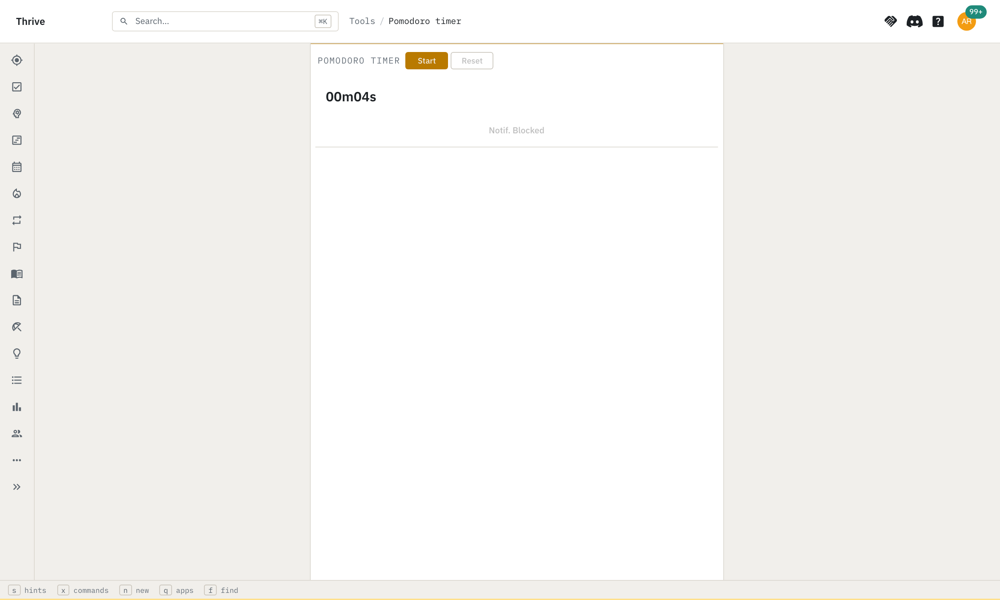

# Pomodoro Timer

Thrive offers a basic [Pomodoro
timer](https://en.wikipedia.org/wiki/Pomodoro_Technique).You can use it during
your work, instead of an external tool.

A CLI command also exists invoked via `thrive pomodoro`.
