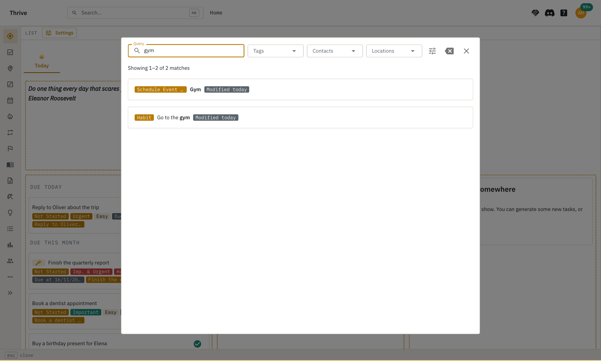

# Search

Thrive has a generic search across entities (inbox tasks, journals, metrics, and
so on): match by name and optional note snippets, with filters for entity type,
archived items, and date ranges.

## WebUI

Use the **search icon** in the workspace header. It opens an overlay where you
can type a query (results load as you go), use the **Tune** control for the same
advanced filters as before, and follow a result to open that entity. There is no
separate Search screen under Tools anymore. The keyboard shortcut is `⌘K`
(`Ctrl+K` on Windows and Linux). See [Keyboard Shortcuts](keyboard-shortcuts.md)
for the other keys.

From the keyboard, `↵` or `↓` in the query moves into the results. Among them
the keys are the ones you chose for the same actions elsewhere (see
[Keyboard Shortcuts](keyboard-shortcuts.md)): next and previous (`j` and `k` to
start with) move along them, open (`↵`) opens the one that has the focus, and
find (`f`) goes back to the query, as previous does from the first; `↓` and `↑`
always move. The one that has the focus is marked with a line of amber on its
left, as an item of a list is, and the bar at the bottom of the window says
which keys work, in the query and among the results. Clearing the query puts the
cursor back in it, ready to type again.

## CLI

A CLI command also exists, invoked via `thrive search`, with equivalent search
and filter behaviour for scripting and terminal use.
