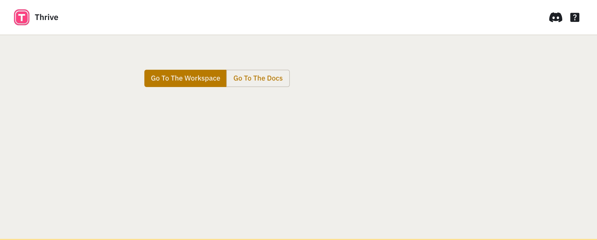
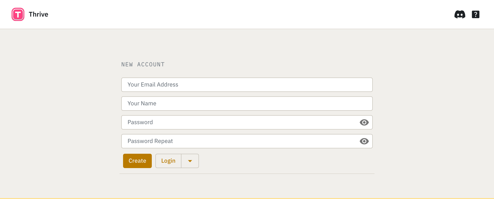
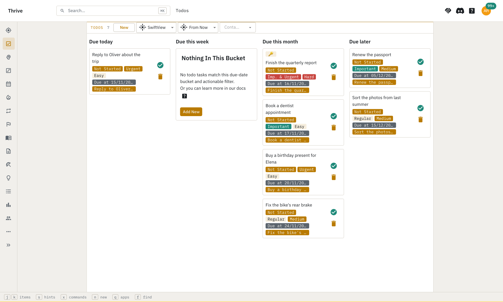
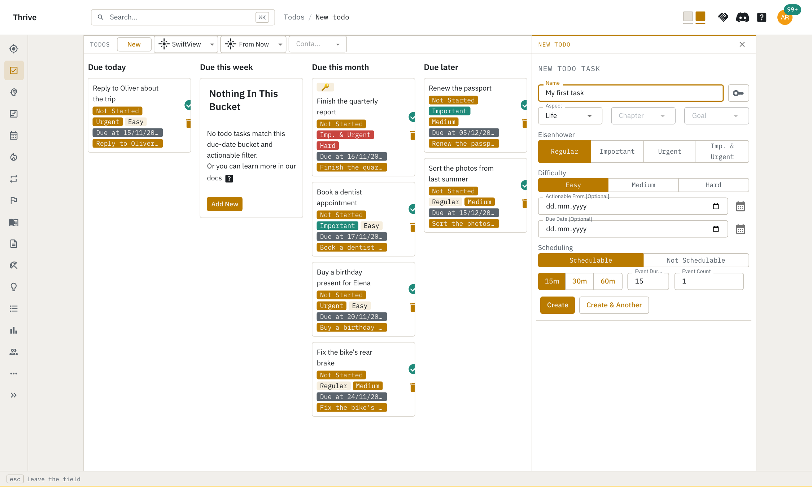
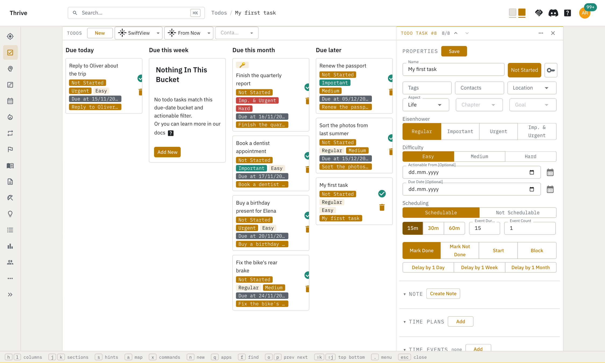
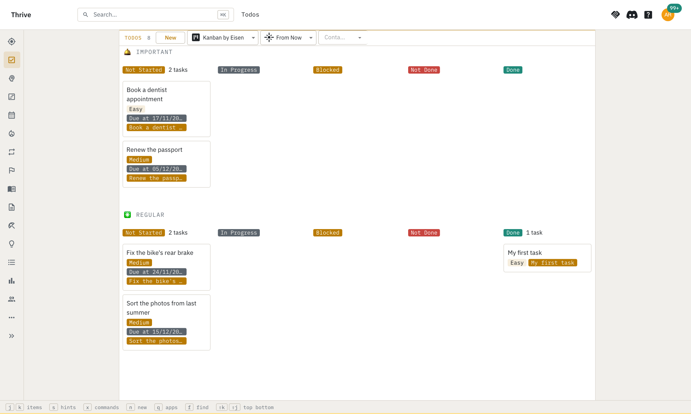

# Tutorial

## Access

First, go to the [Thrive](https://app.get-thriving.com). This is the _hosted_
versionof Thrive, which is the recommended way to start. If you're looking for a
_local_ install,then checkout [installation instructions](how-tos/install.md).
Everything below should work the same.

## Create A Workspace

The _workspace_ is where all your work in Thrive happens. You'll first need to
create one.

On accessing Thrive you should just see a basic button which you _need to
click_.

You'll see a login form. You need to press `New Workspace` and you'll be
prompted with the following:

You can check what the advanced and [feature
flags](concepts/feature-flags.md)accordions if you're curious.

Press `Create` and you will be shown an [account recovery
token](how-tos/recover-your-account.md) thatyou need to store in a safe space.
Once you do that, you can proceed to _your newly created workspace_.

This is where everything lives. The left sidebar lists the apps; open the
`Todos` one. Todos are the simplest way to capture work, and they are the best
place to start:

## Create A Todo

Let's create a todo. Press `New` and a form opens on the right:

Name it `My first task` and press `Create`. It shows up in the list, grouped by
its due date:

Switch over to the `Kanban by Eisen` view, using the view picker at the top of
the list. Open the task and press `Mark Done`. The task moves to the `Done`
column of its Eisenhower row:

You can do all of this from the keyboard too: see [Work With The
Keyboard](how-tos/work-with-the-keyboard.md).

## Congrats

Congrats! You created your workspace and performed your first task on Thrive.
It's a big achievement!

You are now equiped with this fundamental knowledge. Now you can play around, or
read the various partsof this guide to get yourself familiarized with the
possibilities. Checkout [concepts](concepts/overview.md)and
[how-tos](how-tos/install.md) for this more in depth information.

Welcome to Thrive and happy planning!
